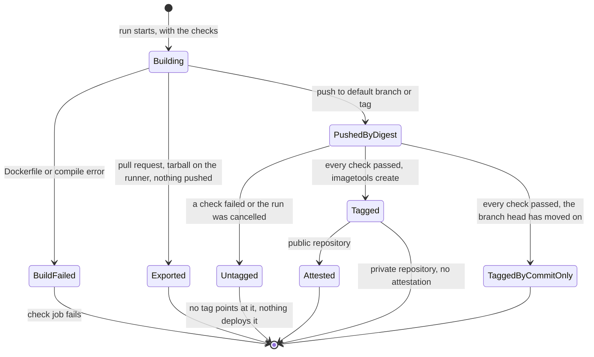
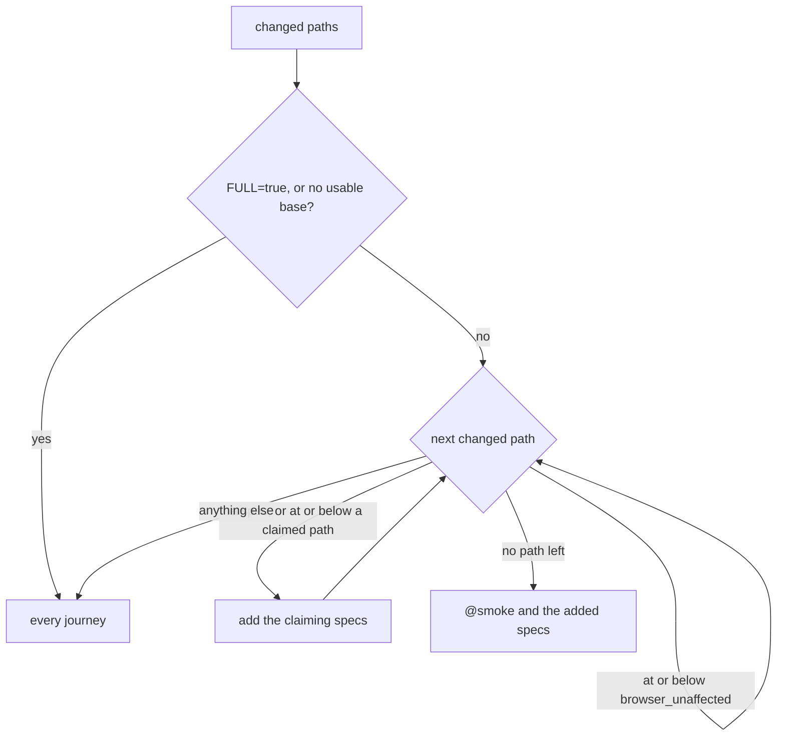
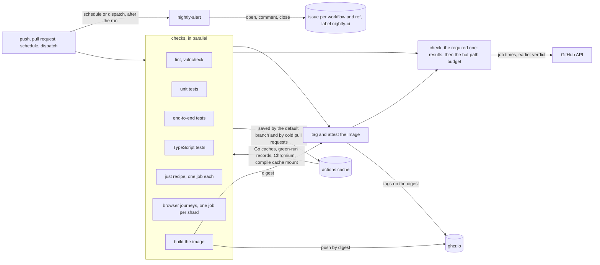
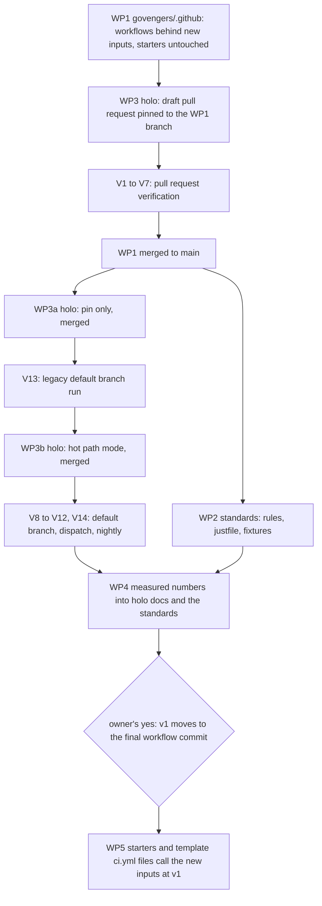
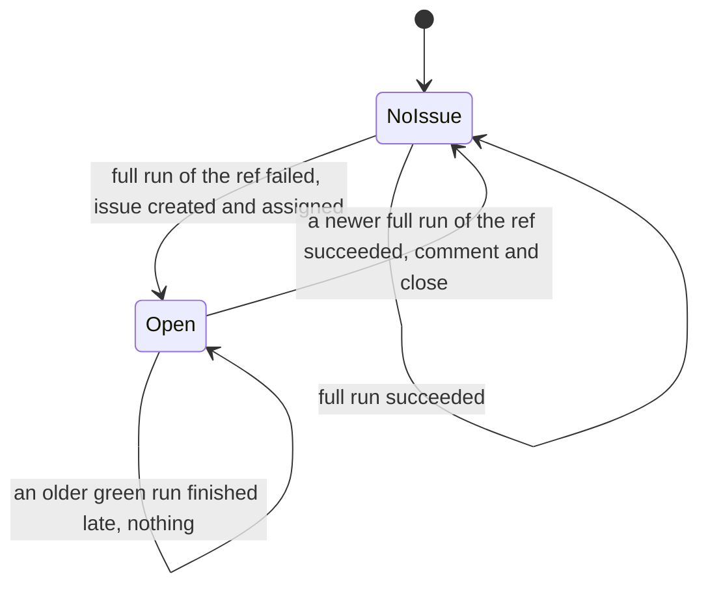

# CI hot path budget: ten minutes from push to pushed image

Plan of 23.11.2026 for three repositories: `govengers/.github` (the reusable workflows, this
repository), `govengers/standards` (the rule and the templates) and `govengers/holo` (the first
consumer). Names in this plan are contracts: inputs, jobs, recipes, environment variables and file
paths are built verbatim. The review rounds are beside this file (`ci-hot-path-budget-codex-round<n>.md`).

## 1. Goal

Any CI that gates a deployment finishes within 10 minutes, as an org rule that CI itself enforces.
The hot path is defined (what it checks, what it leaves to the scheduled run), the full suite runs
nightly, and a red nightly reaches a human. Local runs and the hot path run only what a change
affects: Go through the build and test caches, the browser journeys through a selection that is the
same recipe locally and in CI.

Pipelines are fast today (libraries 1 to 3 min, service pull requests 2 to 5 min, pushes to main 9
to 12 min). The rule is a guard against growth. The failure mode it is written against, described
generically: a service whose pipeline grew to almost an hour without one change that looked slow.
A browser suite of some 240 journeys ran on one worker because the journeys shared state (27 min,
the job's timeout raised from 20 to 30 to 45 minutes); an upgrade test ran serial scenarios with
real 60 s waits (53 min); unit tests ran serially on real timers; all of it sat in front of build
and deploy.

## 2. Scope and non-goals

In scope:

- `go-service.yml`: the image inside the budget, a hard cap judged inside the required check, a
  browser job, green-run records for every recipe job, job timeouts.
- `go-library.yml`: a budget input.
- `nightly-alert.yml`: new reusable workflow, an issue per red scheduled run.
- standards: TST-018 rewritten as the hot path rule, TST-020 rewritten, TST-021 new, TCH-008 and
  TST-014 amended, the templates.
- holo: the consumer side of all of it, including journeys that do not share state.

Not in scope (section 12 lists the follow-ups that need the owner's yes):

- Moving the `v1` tag, rolling out to the two service repositories outside the org that call `@v1`.
- Runner sizing and the runner image (section 10 names what this plan depends on).
- Already in place and not re-planned: TST-014 (test cache), TST-015 (e2e skip record), TST-017
  (5 s per test), per-job Go caches, `@smoke` on pull requests, `full: true` for schedule and tags.
- Not built: a coverage-based test impact analysis for journeys, a cache for Bun's install
  directory, vulncheck records for libraries, cleanup of untagged image versions, a run-wide
  deadline that cancels jobs (section 4 says why).

## 3. Measured today (23.11.2026)

| Fact | Value | Source |
|------|-------|--------|
| holo push to main, checks | 135 to 160 s (longest job: derive-check 133 to 154 s) | runs 44028761491, 44045356524 |
| holo image job, after the checks | 428 s and 545 s | same runs |
| inside the image job: two Go compiles (amd64, arm64), cold | 190 s and 245 s | BuildKit log, steps 31 and 32 |
| inside the image job: `exporting to GitHub Actions Cache` | 111 s and 183 s | BuildKit log, step 41 |
| inside the image job: `go mod download`, never `CACHED` | 38 to 41 s | BuildKit log, step 25 |
| inside the image job: vue-tsc and vite | 36 to 43 s | BuildKit log, step 28 |
| inside the image job: image export and push | 17 to 19 s | BuildKit log, step 39 |
| inside the image job: post step of setup-buildx | 22 to 33 s | job steps |
| holo cache usage on GitHub | 10.5 GB of a 10 GB quota, 855 MB of it BuildKit blobs | `actions/cache/usage` |
| all 23 browser journeys in CI, two workers | 55.9 s | run 45009691195 |
| `ui-ci` in CI | 98 to 108 s warm, never skipped, Chromium downloaded every run | runs above |
| holo pull request on the self-hosted runners | lint 159 s, db-check 140 s, derive-check 276 s, ui-ci 249 s; two unit tests at 5.43 s and 5.4 s against the 5 s budget | run 45226247985 |
| holo nightly | red since 17.11.2026: `ui/e2e/operations.spec.ts:44` expects a changelog heading `/0\.2/`, `VERSION` is 0.1.0 | run 45009691195 |

Two conclusions the design rests on:

1. The image job costs the sum of a cold compile and a cache export, and it runs after the checks,
   so the deploy path is checks plus image: 565 to 705 s. Nothing budgets it.
2. The `type=gha` layer cache does not pay on this pipeline: the repository's quota is
   over-committed, the blobs are evicted, so every run misses (`go mod download` is never
   `CACHED`) and then spends 111 to 183 s exporting the layers again.

## 4. The hot path

**Hot path run.** A run of a caller that sets `hot-path-seconds`, triggered by a pull request or
by a push to the default branch. Nothing else decides it: a caller that passes `full: true` on such
an event still gets the cap and the short timeouts. Scheduled runs, dispatched runs and `v*` tags
are full runs, outside the cap.

**Span.** From `run_started_at`, as the API reports it, to the clock of the required check
`check` itself: its last step judges the budget. `check` needs every check and, on the default
branch, the job that tags the pushed image, so the span ends with the check result on a pull
request and with the pushed image plus the verdict on the default branch. Every wait counts: for
runners, for the image job's turn, for `check`'s own runner. In hot path mode `check` runs on the
runner kind of the checks, so no second runner kind sits in the span. No bound on waiting is
claimed: a busy runner pool makes the run slower, and the verdict says so.

**Cap.** `hot-path-seconds`, 600 s, no margin. The workflow refuses a value above 600. On a pull
request the cap is 60 s lower (540 s): the default branch also pushes the image, saves the compile
cache and tags (measured 17 to 19 s for the push; the rest estimated, re-measured in WP4), and a
pull request must predict that run. A pull request builds the image for every platform and exports
it to a tarball, so compile and compression are inside its measurement.

**Blocking.** The verdict is a step of `check`, the one check branch protection requires. A pull
request over the cap cannot merge; no new required check is needed, and no job can be skipped
around it. On the default branch the cap cannot gate the push it measures: the image is out when
the verdict falls, the red run is the alarm. A re-run of some jobs repeats the earlier verdict;
only an attempt in which every job ran again is measured anew, and without an earlier verdict a
partial re-run fails.

**Early warning.** `budget-warm-seconds` 300 and `budget-cold-seconds` 480 with 20 % margin stay,
judged by the same step over the same span. They fail a pull request long before the cap is near.

**Timeouts are a backstop, not the cap.** Every job of a hot path run that runs the caller's code
has `timeout-minutes: 10`, of a full run 60, and `check` 5; a caller cannot change them. They end
a hung job. They do not add up to a run deadline, and none is built: a deadline that cancels the
run at 600 s would turn the same pipeline red a little earlier and tell nothing more, while the
verdict already blocks the merge. How long a run over the cap takes to turn red is not bounded by
this plan: it is the queue waits plus at most ten minutes per job on the longest chain of needs
(a check, the tag job, `check`).

**Contents.** The starting point of the order is kept; the changes to it carry their reason.

| In the hot path | Recipe or job |
|-----------------|---------------|
| lint, vet | `just lint` |
| unit tests of changed and affected packages, race detector, coverage gate, 5 s per test | `just test` (TST-014, TST-017) |
| API end-to-end suite unless server and suite equal a green run | `just test-e2e` (TST-015) |
| generated code, migrations and queries, OpenAPI against the base | recipes `generate-check`, `db-check`, `openapi-check` |
| frontend type-check, design lint, component and page tests, build | `just test-typescript` |
| the browser journeys the change needs | `just ui-e2e` (section 6) |
| image build for every platform; push by digest and tags on the default branch | jobs `image-build`, `image` |
| govulncheck, only when `go.mod`, `go.sum` or the Go release differ from a green scan | `just vulncheck` with a record |
| derivation check, only when the derivation's own inputs differ from a green run | `just derive-check` with a record |

| Out of the hot path: nightly, `v*` tags and on demand (`workflow_dispatch`) | |
|---|---|
| every unit and end-to-end test uncached and shuffled | `just test-all`, `just test-e2e-all` |
| every browser journey | `FULL=true just ui-e2e` |
| govulncheck regardless of the record | `FULL=true` |
| the derivation check regardless of the record | `FULL=true` |

Changes to the recommended starting point, and one kept on purpose:

- **The image is also built on pull requests** (not pushed). The cap can only stop growth where a
  red result blocks a merge. It replaces holo's `image-check` job in CI.
- **The scheduled run has a bound too**: 60 minutes per job. What moves out of the hot path must
  not grow without limit there either; a nightly over an hour fails and opens an issue.
- **Kept: the vulnerability scan keys on dependencies and toolchain, not on the source.** A source
  change can make a function of an unchanged dependency reachable, and the hot path then does not
  scan. The order wants exactly that trade: a fresh advisory must not hold up an unrelated fix. The
  nightly scan sees it within a day and opens an issue.

## 5. The image inside the budget

Candidates, weighed against the measurements of section 3:

| Candidate | Effect | Verdict |
|-----------|--------|---------|
| A. Build in parallel with the checks, gate only the tags | pipeline becomes max(checks, build) plus about 20 s instead of the sum; alone: 400 to 565 s on GitHub's runners, no room on slower ones | chosen, necessary, not sufficient |
| B. Carry the Go compile cache into BuildKit | the 190 to 245 s compile drops to the changed packages | chosen, with A |
| C. arm64 only on tags | halves a cold compile; `:main` and a release then differ in platforms, and an arm64 break shows at the release | not chosen as default; needs no workflow change (`platforms` is an input a caller may set by expression), kept as the documented lever |
| D. Keep the `type=gha` layer cache | costs 111 to 183 s of export per run and misses anyway (section 3) | dropped in hot path mode |

**Decision: A and B, D dropped.** In hot path mode the image is built by a job that starts with the
checks. On a push it pushes the image by digest, without a tag. After every check passed, the
existing `image` job tags that digest (`docker buildx imagetools create`) and attests it. A deploy
follows tags, so nothing can deploy an image whose checks failed. The compile cache travels as an
`actions/cache` entry: two small `docker buildx build` calls copy it into the Dockerfile's
`--mount=type=cache` before the build and out of it afterwards (never with `--no-cache`, which
empties cache mounts). No layer cache: `go mod download`
(about 40 s) and the frontend build (about 40 s) run every time, in parallel stages, in a job that
runs beside the checks.

Expected: image build about 180 s warm on GitHub's runners (setup 15, cache restore and inject 25,
frontend and Go stages in parallel 85, export and push 17, extract and save 30), 350 to 400 s with
a cold compile cache. Hot path warm about 200 to 220 s, cold about 420 s.

**The `type=gha` question.** Whether BuildKit's `type=gha` cache works against the in-cluster
cache server is unverified. This design does not depend on it: it uses `actions/cache`, which the
Go caches already use against that server. The check that remains is whether the cache mount
transfer works on the self-hosted runners (Docker in Docker, `docker-container` driver); V3 in
section 9 names it, with this fallback chain:

1. The inline transfer fails there: use `reproducible-containers/buildkit-cache-dance` (newest v3
   release, pinned by commit SHA), which does the same two builds. Its extraction runs in a post
   step, so the order becomes: `actions/cache/restore` with `lookup-only` (for `cache`), the
   combined `actions/cache` on default-branch pushes or `actions/cache/restore` otherwise, the
   action with `skip-extraction` outside default-branch pushes, the build; the action's post step
   extracts, then the combined cache's post step saves. Pull requests then never save, so this
   variant is verified by a push to a test caller's default branch.
2. No transfer works at all: the build compiles cold in parallel (candidate A alone). That holds
   the cap only at the speed of GitHub's runners.
3. Still over: the caller sets `platforms` to `linux/amd64` on the default branch and both
   platforms on tags (candidate C).

`type=gha` stays in the legacy path (no `hot-path-seconds`), unchanged, for the v1 callers.

**Order of the moving tag.** The caller's run-level concurrency group serializes the pushes of a
branch (the starter has it), and the `image` job keeps its own group. Neither stops a re-run of an
older run's `image` job from pointing `:main` back. The tag step, inside that group, therefore
asks the remote for the branch's head (`git ls-remote`) and writes the branch tag only when the
head is the run's commit; the `sha-` tag is always written. That is right for a rollback (the head
is the older commit, its run moves the tag) and for diverged history (an old run is not the head).
The price: a commit that is superseded before its tag job runs never carries `:main`; the head
that follows it does, when it is green.



## 6. Browser journeys selected by the change

One recipe, `just ui-e2e`, locally and in CI. It asks `just browser-select` which journeys the
change needs and passes the answer to `playwright test --grep`.

**Changed paths.** In CI the workflow sets `BASE_SHA` (the pull request's base commit; on a push
the commit before the push) and the recipe compares it directly with the checkout:
`git diff --name-only --no-renames "$BASE_SHA"`. A direct comparison also sees a push that moves
the branch backwards. Locally there is no `BASE_SHA`: the merge base of `HEAD` with
`origin/${BASE_REF:-main}` against the working tree, plus `git ls-files --others
--exclude-standard`. `--no-renames` lists the old and the new path of a rename. A base that is not
a commit in the clone (a first push, zeros, a shallow clone): every journey.

**Claims.** A spec names the paths whose journeys it holds in one comment line, repository
relative, space separated; a path may be claimed by several specs:

```ts
// covers: ui/src/pages/Users ui/src/pages/Account
```

Convention first: a spec always covers itself, and `@smoke` journeys always run. The claim line is
the only hand-kept part beside one list (below), it lives in the spec it describes, and forgetting
it is safe.

**Rules, in this order, per changed path.**

1. `FULL=true`: every journey.
2. The path is a spec, or lies at or below a path some spec claims: those specs, whole. Claims come
   first, so a claimed Markdown file (the changelog a page renders) or a claimed test file selects
   its spec.
3. Else the path lies at or below an entry of `browser_unaffected`: nothing beyond smoke. The list
   names what the journeys do not need beyond smoke: the backend (the API end-to-end suite covers
   it, as the order recommends) and prose. It is explicit and short; holo's is in WP3.
4. Else: every journey. This is the default for every path nobody classified: shared components,
   the generated API client, the lockfile, the Playwright configuration, the justfile, a page no
   spec claims, a new top-level directory.
5. The result is `all`, or the pattern `@smoke|<spec>\.spec\.ts|...`, each spec once. Playwright
   matches `--grep` against the file name, the titles and the tags of a test (verified with
   1.65.1: `--grep "session\.spec\.ts|@smoke"` lists the four journeys of that spec and every
   smoke journey), so one invocation runs the selection.
6. A claimed path that does not exist fails `browser-select` with the spec and the path: a typo or
   a deleted page is fixed in the claim, not silently unmapped.



**Honest limit.** A change of the API contract regenerates the shared client, which is rule 4:
every journey. Selection saves the page-only and backend-only changes; what keeps the browser run
inside the budget in every case is the next paragraph.

**Keeping every journey inside the budget.** Journeys run in parallel on state of their own: a
journey creates what it asserts on (its project, its tasks, and its own person where it asserts on
a person's inbox or settings) and never reads what another journey wrote. The recipe passes
`--fully-parallel`, `--workers` (at least two) and `--global-timeout`: 180 s for a selected run,
600 s with `FULL=true`. So the timeout and the defaults hold whatever the Playwright configuration
says; a serial block in a spec or a worker limit of a project still wins over the flags, and that
is what TST-020's check and the harness contract forbid. A suite that no longer fits gets a shard
(`browser-shards`), never a longer timeout and never fewer workers. One worker with shared state is
the failure mode of section 1.

**Skip record.** As today (TST-015), with a complete key, computed after the frontend build (so
the server binary in the key embeds this run's frontend, on a fresh checkout as on the tenth run):
the binaries the journeys execute (`browser_binaries`: the server and every Go program the harness
runs, the database launcher included, built reproducibly, so Go code, its dependencies and what it
embeds are in the key through them), every file that exists, that git tracks or does
not ignore, and that is not below `browser_unaffected` (path and content), the Bun version, the
selection and `SHARD`. So `browser_unaffected` may hold only Go code and embedded files (the
binaries fingerprint them) and files no journey process reads. A record is read and written only
by a run without extra flags: `just ui-e2e --list` or a narrowed run proves nothing. A record
satisfies exactly its own selection and shard. CI now carries the records and Chromium's download
between runs.

## 7. Architecture



## 8. Work packages



WP1 merges only after V1 to V7 and V15. Every new input defaults to today's behaviour, and the
legacy image, budget and record steps are today's,
so the final workflow commit (WP1 plus any correction of WP4) can become `v1` without a change in
any caller. What a caller without new inputs does see is listed under "Compatibility" below. WP3 starts before WP1 merges because a
reusable workflow is verified from a caller's pull request (README "Versioning"). The four files
that call `@v1` (two starters here, two template `ci.yml` in the standards) change only after the
tag moved: before that, `v1` knows neither the inputs nor `nightly-alert.yml`, and a repository
created from them would not start.

### WP1 govengers/.github

#### `.github/workflows/go-service.yml` (changed)

New inputs:

| Input | Type | Default | Meaning |
|-------|------|---------|---------|
| `hot-path-seconds` | number | `0` | hot path mode and its cap. `0`: today's behaviour. Above 0: the image is built in parallel with the checks (pull requests too, not pushed), `check` judges the cap, jobs get timeouts. A value above 600 fails |
| `browser` | string | `""` | the justfile recipe that runs the browser journeys, e.g. `ui-e2e`. Empty: no browser job |
| `browser-shards` | number | `1` | Playwright shards, 1 to 8, one job each; the workflow builds the complete set |

Two expressions used below, written once here:

- `HOT`: `inputs.hot-path-seconds > 0 && (github.event_name == 'pull_request' || (github.event_name
  == 'push' && github.ref == format('refs/heads/{0}', github.event.repository.default_branch)))`.
- `RUNNER`: the `runs-on` expression of the jobs that run the caller's code today (the caller's
  `CI_RUNNER`, `ubuntu-latest` for a fork's pull request or without the variable).

Environment the recipes see, beside `FULL` and `BASE_REF`:

| Variable | Value | Jobs |
|----------|-------|------|
| `BASE_SHA` | `${{ github.event.pull_request.base.sha \|\| github.event.before }}` | `recipes`, `browser` |
| `SHARD` | `${{ matrix.shard }}/${{ inputs.browser-shards }}` | `browser` |

Jobs:

| Job id | Name | Change |
|--------|------|--------|
| `lint`, `recipes` | unchanged | in hot path mode restore and save the green-run records; `timeout-minutes` |
| `test`, `typescript`, `e2e` | unchanged | `timeout-minutes` (`e2e` keeps its own record cache steps as they are) |
| `browser` | `browser journeys` (with more than one shard: `browser journeys 1/2`) | new |
| `image-build` | `build the image` | new |
| `image` | `build, attest and push the image` (unchanged) | in hot path mode it tags the digest instead of building |
| `budget` | `pipeline budget` (unchanged) | `if` gains `&& inputs.hot-path-seconds == 0`; steps, needs and runner untouched |
| `check` | unchanged | `needs` gains `browser`, `image-build`, `image`; a second step `Hot path budget`; runner and timeout in hot path mode |
| `badges` | unchanged | `needs` gains `browser` |

Details, in the order of the file:

1. **Timeouts.** Every job that runs the caller's code (`lint`, `test`, `e2e`, `typescript`,
   `recipes`, `browser`, `image-build`, `image`) gets
   `timeout-minutes: ${{ inputs.hot-path-seconds > 0 && ((HOT) && 10 || 60) || 360 }}` with `HOT`
   written out (anchor the scalar once if actionlint accepts an alias there, else repeat it). 360
   is GitHub's default, so a caller without the input sees no change. The timeout is not an input
   and does not follow `full`.
2. **Green-run records.** Two new anchored steps beside the Go cache anchors, used by `lint`,
   `recipes` and `browser`, both only in hot path mode (`inputs.hot-path-seconds > 0` in their
   `if`): a caller without the input carries no new record, so a recipe of its own that happens to
   write `sandbox/*-passed` runs in CI exactly as today. Each job sets `RECORDS_JOB` (`lint`,
   `recipe-<recipe>`, `browser-<shard>-of-<shards>`), so no two jobs of a run write one key:
   - `&records-restore`: `actions/cache/restore@v6`, path `sandbox/*-passed`, key
     `passed-${{ env.RECORDS_JOB }}-${{ github.sha }}-${{ github.run_id }}-${{ github.run_attempt }}`,
     restore key `passed-${{ env.RECORDS_JOB }}-`.
   - `&records-save`: `actions/cache/save@v6`, same path and key, `if: ${{ !cancelled() &&
     inputs.hot-path-seconds > 0 && hashFiles('sandbox/*-passed/**') != '' }}`.
   Restored on full runs too: the recipes ignore records when `FULL=true`, and a green full run
   writes them. Run id and attempt in the key keep a scheduled run, or a re-run, on a commit that
   already saved from failing to save. The `e2e` job keeps its own steps and its key
   `e2e-passed-`, untouched. A caller that sets `browser` without `hot-path-seconds` gets the
   browser job without records.
3. **`browser` job.** `if: inputs.browser != ''`. Matrix `shard: ${{
   fromJSON('{"1":[1],"2":[1,2],"3":[1,2,3],"4":[1,2,3,4],"5":[1,2,3,4,5],"6":[1,2,3,4,5,6],"7":[1,2,3,4,5,6,7],"8":[1,2,3,4,5,6,7,8]}')[format('{0}',
   inputs.browser-shards)] }}` (expressions have no arithmetic; a value outside 1 to 8 yields no
   matrix and the run fails at once), `fail-fast: false`, `CACHE_JOB: browser`, permissions
   `contents: read`, `runs-on` `RUNNER`. Steps: checkout with `fetch-depth: 0`; the Go, cache, just
   and Bun anchors; `*records-restore`; Chromium's cache (`actions/cache/restore@v6`, id
   `playwright`, path `~/.cache/ms-playwright`, key `playwright-${{ runner.os }}-${{
   hashFiles('**/bun.lock') }}`); `just "$RECIPE"` with `RECIPE: ${{ inputs.browser }}`,
   `BASE_SHA`, `SHARD`; on `failure()` `actions/upload-artifact@v7`, name `browser-report-${{
   matrix.shard }}`, paths `**/playwright-report/**` and `**/test-results/**` without
   `**/node_modules/**`, 7 days; `actions/cache/save@v6` of Chromium when
   `steps.playwright.outputs.cache-hit != 'true'` and not cancelled, keyed on the restore step's
   `cache-primary-key` (a second `hashFiles` after the install could take in a package's own
   lockfile); `*records-save`;
   `*cache-save` (the shards save one Go cache key; the first wins, the others log that it exists).
   The recipe installs the browser, the workflow only carries its directory.
4. **`image-build` job.** `if: inputs.hot-path-seconds > 0 && (github.event_name ==
   'pull_request' || (github.event_name == 'push' && (github.ref == format('refs/heads/{0}',
   github.event.repository.default_branch) || startsWith(github.ref, 'refs/tags/v'))))`, `runs-on`
   `RUNNER`, permissions `contents: read`, `packages: write` (every caller already grants it for
   `image`). Outputs: `digest`, `cache` (`warm` or `cold`). Steps:
   1. checkout.
   2. `docker/setup-buildx-action` (the pinned SHA of the `image` job), id `buildx`.
   3. `docker/login-action`, `if: github.event_name == 'push'`.
   4. `docker/metadata-action`, id `meta`, for the labels only: `images: ${{ inputs.image }}`,
      tags `type=ref,event=branch`, `type=semver,pattern={{version}}`, `type=sha` (the same
      version label as today; the moving tags are decided in `image`).
   5. `actions/cache/restore@v6`, id `mounts`: path `sandbox/image-mounts`, key
      `<prefix>-${{ github.sha }}` with `<prefix>` = `image-mounts-${{ runner.os }}-${{
      hashFiles(inputs.dockerfile) }}`, restore keys `<prefix>-` and `image-mounts-${{ runner.os
      }}-`. `cache` is `warm` when `cache-matched-key` starts with `<prefix>-`, else `cold`. A step
      `Compile cache key` (id `mounts-key`) before it writes `<prefix>` to its output, as
      `cache-paths` does for the Go caches: a job output cannot call `hashFiles`.
   6. `Inject the compile cache`, when `sandbox/image-mounts/go-build` holds files: one
      `docker buildx build` with the directory as context, `--build-arg STAMP=${{ github.run_id
      }}-${{ github.run_attempt }}` and an inline Dockerfile: a digest-pinned `busybox` from
      `public.ecr.aws/docker/library` (no Docker Hub pull limit), `ARG STAMP`, then
      `RUN --mount=type=cache,target=/root/.cache/go-build --mount=type=bind,target=/in echo
      "$STAMP" && cp -a /in/. /root/.cache/go-build/`. No `--no-cache`: BuildKit empties cache
      mounts under it; the stamp is what keeps the layer from being reused. The mount target is
      the one of the service template's Dockerfile; cache mounts are keyed by target inside the
      builder, so the service's build finds the files. A Dockerfile without that mount builds as
      before, uncached.
   7. `docker/build-push-action` (the pinned SHA), id `build`: `context: .`, `file`, `platforms`,
      `labels`, `build-args: VERSION=...` as in `image`; no `cache-from`, no `cache-to`; on a push
      `outputs: type=image,name=${{ inputs.image }},push-by-digest=true,name-canonical=true,push=true`,
      on a pull request `outputs: type=oci,dest=${{ runner.temp }}/image.tar` (every platform
      exported and compressed, nothing pushed).
   8. `Extract the compile cache` and `actions/cache/save@v6` (path and key of step 5), both with
      the save rule of the Go caches: a push to the default branch, or a pull request whose
      `cache` is `cold`; not when cancelled. The extraction empties `sandbox/image-mounts/go-build`
      and runs one `docker buildx build --output type=local,dest=sandbox/image-mounts/go-build`
      on an empty context with the same `STAMP` argument and an inline two-stage Dockerfile: the
      pinned `busybox` with `ARG STAMP` and `RUN --mount=type=cache,target=/root/.cache/go-build
      echo "$STAMP" && mkdir /out && cp -a /root/.cache/go-build/. /out/`, then `FROM scratch` and
      `COPY --from=0 /out /`. It prints the number of files it extracted; zero is a warning
      annotation, not a failure (a Dockerfile without the mount is allowed), and nothing is saved
      then.
5. **`image` job.** `needs` gains `browser` and `image-build`; the `if` is unchanged (a failed
   need already keeps it from running). Shared steps stay first: checkout with `fetch-depth: 0`,
   `newest`, setup-buildx, login, `meta`. Then:
   - legacy, `if: needs.image-build.result == 'skipped'`: today's `build` step, unchanged.
   - hot path, `if: needs.image-build.result == 'success'`: step `promote`, plain bash, no `jq`:
     the tags are the lines of `steps.meta.outputs.tags`. On a branch ref it first asks
     `git ls-remote origin "refs/heads/<branch>"` and drops the branch tag from the list when the
     answer is not `GITHUB_SHA`, with the log line `<image>:<branch> not moved: the branch head is
     <sha>, this run built <sha>`. Then `docker buildx imagetools create` with one `-t` per remaining tag and the source
     `${{ inputs.image }}@${{ needs.image-build.outputs.digest }}`, and it writes the digest the
     `sha-` tag resolves to (`docker buildx imagetools inspect --format '{{.Manifest.Digest}}'`,
     the plain value, no JSON quoting) to its `digest` output.
   - attestation: `subject-digest: ${{ steps.build.outputs.digest || steps.promote.outputs.digest }}`.
   The concurrency group stays on `image`.
6. **`check` job.** `needs: [lint, test, e2e, typescript, recipes, browser, image-build, image]`,
   `if: always()` as today, `runs-on: ${{ inputs.hot-path-seconds > 0 && (RUNNER) ||
   'ubuntu-latest' }}`, `timeout-minutes: ${{ inputs.hot-path-seconds > 0 && 5 || 360 }}`. The
   `permissions: {}` line goes: the job takes the caller's grant like `budget` (design S3), since a
   declared `actions: read` would fail every caller that does not grant it; it still checks
   nothing out and runs only the workflow's own two steps.
   - Step `Every job passed or was skipped by its input`: `RESULTS` is spelled out instead of
     `needs.*.result`: the five of today, `needs.browser.result`, `needs.image-build.result`, and
     `${{ inputs.hot-path-seconds > 0 && needs.image.result || 'skipped' }}`. Without
     `hot-path-seconds` the verdict is today's; `image` is in `needs` only so that `check`'s clock
     comes after the pushed image. New, and only for jobs a new input switches on: a job that the
     inputs and the event enable must have succeeded, a skip does not pass. `browser` when
     `inputs.browser != ''`; `image-build` when its own `if` holds; `image` in hot path mode on a
     push to the default branch or a `v*` tag. The step gets three expressions as environment
     (`EXPECT_BROWSER`, `EXPECT_IMAGE_BUILD`, `EXPECT_IMAGE`) and fails with the job's name when
     one is true and the result is not `success`.
   - Step `Hot path budget`, `if: ${{ always() && (HOT) }}`, one `actions/github-script@v9` step
     (no `gh`, no `jq`: the self-hosted image is not assumed to have them), in this order:
     1. `hot-path-seconds` above 600: fail with `hot path: hot-path-seconds is <n>, above the org
        cap of 600 s (TST-018)`.
     2. Read the run attempt and its jobs (paginated); unreadable: fail with the hint to grant
        `actions: read`.
     3. Write the summary table: job, runner (`runner_name`), queued seconds (`started_at` minus
        `created_at` where both exist and the difference is not negative, else a dash: a job
        carried into a re-run keeps old timestamps), run seconds; then `**hot path** (<warm|cold>
        caches, attempt <n>) | <elapsed>`. `elapsed` = now minus `run_started_at`, sampled once
        more as the last statement before the verdict, so only the end of the job lies behind it.
     4. A re-run attempt is complete only with evidence for every expected job. The expected jobs
        follow from the inputs and the needs: each need whose result is not `skipped`, one job
        per entry of `inputs.recipes`, one per shard of `inputs.browser-shards`. Each must be in
        the attempt's list with a `started_at` at or after the attempt's `run_started_at`. One
        missing, or older (it did not run again): the attempt is partial; read the step `Hot path
        budget` of the `check` job of the previous attempt. It succeeded: pass, `earlier verdict stands`. It
        failed: fail with `hot path: attempt <n-1> broke the budget and this re-run did not repeat
        every job; make the pipeline faster or re-run all jobs`. No such step, or it was skipped or
        cancelled: fail with `hot path: no verdict of a complete attempt; re-run all jobs`. An
        attempt in which every job ran again is judged like a first attempt.
     5. The cap, independent of the two budgets below: `cap` = `hot-path-seconds`, minus 60 on a
        pull request. `elapsed` above `cap`: fail with `hot path: <elapsed> s, over the cap of
        <cap> s (TST-018)`.
     6. The early warning, only when the budget of the run's kind is above 0: `cold` when the test
        job or `image-build` reports `cold`; `elapsed` above the budget plus
        `budget-margin-percent`: fail with today's message.
7. **`budget` job.** Only the `if` changes. A caller without `hot-path-seconds` keeps today's job,
   span, runner and verdict.
8. **Compatibility**, what a caller that sets none of the new inputs sees, all of it: `check`
   reports after the image job on a push to the default branch or a tag, with the same result as
   today (pull requests: no difference); `check` no longer declares empty permissions. Nothing
   else: image, budget, the record cache of the end-to-end job, job names and every other step
   are today's, and the new record steps do not run.
9. **Header comment** of the file: the hot path mode, the three inputs, `BASE_SHA`, `SHARD`.

#### `.github/workflows/go-library.yml` (changed)

- New input `budget-seconds` (number, default `0`: none).
- `check` job: `timeout-minutes: ${{ inputs.budget-seconds > 0 && 60 || 360 }}` (the bound of a
  full run; a library's hot run is bounded by the budget step).
- First step of `check`: `Start the budget clock`, writes `BUDGET_START=$(date +%s)` to
  `$GITHUB_ENV`.
- Last step: `Budget`, `if: ${{ !cancelled() && !inputs.full && inputs.budget-seconds > 0 }}`,
  fails with `budget: the checks took <n> s, over the budget of <m> s (TST-018)`. The job's own
  time, no API call, so no new permission. Queue time is not counted: a library gates no
  deployment.

#### `.github/workflows/nightly-alert.yml` (new)

Reusable workflow `Nightly alert`, called by a second job of the caller's `ci.yml` after the CI
job. Inputs: `result` (string, required): `needs.<ci job>.result`; `assignees` (string, required):
comma separated GitHub logins, in the starters `${{ vars.CI_ALERT_ASSIGNEES }}`. One job `alert`,
name `nightly alert`, `runs-on: ${{ vars.CI_RUNNER || 'ubuntu-latest' }}` (the runner kind of the
checks), permissions `issues: write`, `actions: read`. One `actions/github-script@v8` step:

- Job `concurrency`: group `nightly-alert-${{ github.workflow_ref }}`, `cancel-in-progress:
  false`: two runs never reconcile the same issue at once.
- The issue of a monitored workflow on a ref is the open issue with the label `nightly-ci` whose
  body carries the marker `<!-- nightly-alert <github.workflow_ref> -->` (the workflow file and
  the full ref, so two workflows, or a branch and a tag of one name, never share an issue). Title:
  `<workflow name> is red on <ref name>`. A probe on a branch never touches the default branch's
  issue. The body also carries `<!-- last-red-run <run number>.<attempt> -->`, and a closed issue
  `<!-- closed-by-run <run number>.<attempt> -->`; runs are compared by number, then attempt.
- First, before any change: `assignees` is split at commas and trimmed, and every login is checked
  with the assignability endpoint (`GET /repos/{owner}/{repo}/assignees/{login}`); the valid ones
  are used.
- `result` is `failure`: no such issue: when the newest closed issue with the marker was closed
  by a newer run than this one, nothing (a late old red run); else create the label if missing,
  then the issue, body: the
  run's URL, the ref, the failed jobs of the attempt with their links, the sentence that every
  further red run comments and the first later green run closes it, and both markers. An issue is
  open: comment with the run's URL and the failed jobs, and raise `last-red-run` when this run
  is newer. In both cases the issue's assignees are brought to `assignees` (missing ones
  added), so an issue born unassigned gets its assignee with the next red run.
- `result` is `success` and the issue is open: when this run is newer than `last-red-run` (a
  re-run of the red run counts: same number, higher attempt), comment `green again: <run URL>`,
  write `closed-by-run` and close; an older green run that finishes late leaves it open.
- anything else (`cancelled`, `skipped`): nothing. A job that hit its timeout makes `result` a
  failure, so a full run over its hour alerts like any red run.
- Last, on every run, red or green: no valid login, or a login that cannot be assigned, or an
  open issue that still has no assignee: fail with `nightly alert: <what>; a red run would reach
  nobody (CI_ALERT_ASSIGNEES)`.



A separate workflow instead of a job inside `go-service.yml` and `go-library.yml`: a called job
that declares `issues: write` fails every v1 caller that does not grant it at startup (design S3),
and the same alert serves both workflows and a caller with jobs of its own.

#### `README.md`, `docs/design.md` (changed)

- README: job table (browser journeys, build the image, the two modes of the image job, the hot path
  step of `check`), the three inputs, `budget-seconds`, a section "Hot path" (run, span, cap, pull request
  allowance, what the timeouts are, re-runs), a section "Nightly alert" with the caller snippet of
  WP5 pinned by commit until `v1` moves, "Caches" (records for every job, Chromium, the compile
  cache mount; no layer cache in hot path mode and why), "Runners" (in hot path mode `check` runs
  on `CI_RUNNER`), "Versioning" (the compatibility list of this plan), and the caller contract: one concurrency group per ref
  and event (`ci-${{ github.ref }}-${{ github.event_name }}`), so a full run and a push do not
  wait for each other.
- design.md: S3 gains a paragraph (the legacy budget is frozen; the hot path step inside `check`,
  its span, the cap, the org limit, re-runs); new S9 "The image is built beside the checks and tagged after
  them", S10 "The compile cache travels as a cache mount, not as layers" (with the numbers of
  section 3), S11 "A browser job with shards, selection in the recipe", S12 "Green-run records for
  every job", S13 "The nightly alert is its own workflow", S14 "Timeouts are not an input", S15
  "The required check judges the hot path", S16 "Only the branch head moves the branch tag".

### WP2 govengers/standards

No project name in any rule or template; the reference numbers speak of "the first service".

#### `rules/core/testing.md` (changed)

- **TST-018, rewritten in place.** Heading `### TST-018 The hot path stays under ten minutes, and
  CI fails over it`. Severity `must` (the owner states it as a hard rule; a `must` is what the org
  declared non-negotiable). Principle P8. Check: a pipeline that gates a deployment without a cap
  from the run's start to the pushed image (pull request: to the required check), or with a cap
  above 600 s; a cap that only prints, or that is not judged inside the check branch protection
  requires; a job
  timeout raised to make room instead of the suite made faster, split or moved to the scheduled
  run; a pull request pipeline that does not build the image the default branch pushes; a
  scheduled run that does not run what the hot path leaves out; with the govengers service
  workflow `hot-path-seconds` unset or above 600, or the warm and cold budgets unset; with the
  library workflow `budget-seconds` unset. Body: the definitions and the two tables of section 4,
  the cap and the early warning, 60 minutes for the full run, the generic failure mode of section
  1, the reference table (updated in WP4).
- **TST-020, rewritten in place.** Heading `### TST-020 Browser journeys run in parallel on their
  own state; a change runs the journeys it needs, the scheduled run all of them`. Severity
  `should`. Check: a Playwright run with one worker, without full parallelism, or with a serial
  block; a journey that reads what another journey wrote, asserts on a shared person's inbox or
  counters, or depends on order; a pull request that runs every journey whatever changed, or
  smoke only although the change touches a frontend area; a selection in which a path nobody
  classified runs less than every journey; a selection that differs between CI and the local
  recipe; no `@smoke` tag; a selected run without a global timeout of at most 180 s; a suite kept
  inside it by a longer timeout instead of a shard; the full set not run on the scheduled run and
  on `v*` tags; a browser job that downloads the browser every run or uploads no report on
  failure. Body: section 6 in rule prose, the claim line, the recipe reference to the template.
- **TST-021, new.** Heading `### TST-021 A red scheduled run opens an issue with an assignee`.
  Severity `must`, principle P8. Check: a scheduled full run without a step that opens or updates
  an assigned issue when it fails (the govengers `nightly-alert.yml`); an alert that only mails
  whoever last edited the workflow; an issue a later green run leaves open; a full run and the
  pushes of a branch in one concurrency group. Body: what leaves the hot path is checked nowhere else, so a
  silent red nightly is an unchecked rule; where it bit: a journey of the full set was red for six
  nights and nobody was told.
- **TST-014**: the paragraph on the scheduled run names `workflow_dispatch`, the vulnerability
  scan and TST-021; the check gains "a scheduled run nobody is told about (TST-021)".
- **TST-015**: one sentence: a skip record says "nothing changed", the selection of TST-020 says
  "which part changed"; the journeys use both, and the record's key includes the selection.

#### `rules/core/toolchain.md` (changed)

- **TCH-008** (stays `must`). Check: CI that does not run `govulncheck ./...` when `go.mod`,
  `go.sum` or the Go release changed and on every scheduled run; the machine-readable formats as
  the gate (unchanged). New paragraph: the vulnerability database changes without the code
  changing, so a finding is news about the dependencies, not about the change in front of it; the
  scan runs when dependencies or toolchain change and every night, where a finding opens an issue
  (TST-021), and an unrelated fix is not held up by a fresh advisory. The price, said in the rule:
  a source change that newly reaches a vulnerable function of an unchanged dependency is found by
  the night's scan, not by its pull request.
- **TCH-005**: `just ui-e2e` (the journeys a change needs) among the standard recipes of a
  service with a frontend.

#### `rules/service/deployment.md` (changed)

- **DEP-002**: one sentence after the template link: the compile cache mount is carried between
  CI runs by the service workflow; dependency layers stay for local builds.

#### Templates and their checks

- `templates/service/justfile`:
  - variables `browser_specs := "ui/e2e"`, `browser_binaries := "./cmd/server
    github.com/govengers/postgrestest/cmd/postgrestest"`,
    `browser_unaffected := "cmd internal pkg test docs docker .github go.mod go.sum sqlc.yaml
    openapi.yaml README.md"` (with the comment of section 6: only Go code and embedded files,
    which the binaries fingerprint, and files no journey process reads), `browser_workers := "2"`,
    `browser_budget_ms := "180000"`.
  - `vulncheck` with the record: key `shasum` of `go.mod`, `go.sum` and `go env GOVERSION`,
    record `sandbox/vulncheck-passed/<key>`, skipped unless `FULL=true`, written after a green
    scan.
  - `browser-select *paths`: section 6. With arguments it judges those paths instead of asking
    git (the form the tests use). Prints `all` or the pattern. Paths are read line by line, so a
    path with a space is one path.
  - `ui-e2e *flags`: builds the frontend, then `browser_binaries` (reproducibly, as `e2e-build`
    does, into `sandbox/ui-e2e/`), computes the key, installs the browser when `CI` is set (`bunx playwright install --with-deps
    --only-shell chromium`), skips on a record (section 6; no record with flags), else `bunx
    playwright test --fully-parallel --workers={{browser_workers}}
    --global-timeout={{browser_budget_ms}}` (600000 with `FULL=true`) with `--grep "<pattern>"`
    unless `all`, `--shard=$SHARD` when set, `{{flags}}`; writes the record.
  - `ui-e2e-all *flags`: `FULL=true` and `ui-e2e`.
  - `check` gains `ui-e2e`.
- `templates/service/docker/server.Dockerfile`: the comment on the compile cache mount ("in CI it
  starts empty") becomes "CI carries it between runs (go-service.yml)". No instruction changes.
- `templates/README.md`: the `justfile` row and the bullets of "How the test scoping works"
  (journeys selected, records for vulncheck), and a paragraph "What `ui-e2e` expects of the
  frontend", the harness contract: `@playwright/test` pinned in `ui/package.json`; a
  `ui/playwright.config.ts` with `testDir: 'e2e'` and a `globalSetup` that starts the binary in
  `E2E_SERVER` on a scratch database and exports the base URL; specs in `ui/e2e/*.spec.ts`, each
  with a `// covers:` line, smoke journeys tagged `@smoke`; every journey on its own state; no
  serial block and no worker limit in the configuration. The
  template ships no frontend, as for `test-typescript`: the first service is the worked example,
  and it runs this recipe text (T3, T4). The lines on `ci.yml` wait for WP5.
- `README.md`: the `TST` row of the index names the hot path, the selected journeys and the
  nightly alert.
- `playbooks/deriving-an-application.md` line 118: the browser journeys of the core object, one
  of them `@smoke`, in a spec that claims the object's pages.
- `.github/testdata/journeys/` (new), a miniature repository: `ui/e2e/accounts.spec.ts`
  (`// covers: ui/src/pages/Users`), `ui/e2e/tasks.spec.ts` (`// covers: ui/src/pages/Board
  ui/src/pages/Task changelog`), `ui/e2e/broken.spec.ts.txt` (a spec with a claim on a missing
  path, copied in by the test that needs it), and `.gitkeep` files in `ui/src/pages/Users`,
  `ui/src/pages/Board`, `ui/src/pages/Task`, `ui/src/ui`, `changelog`, `internal/service`.
- `.github/workflows/templates.yml`: a step `justfile journey selection` that runs
  `just --justfile templates/service/justfile --working-directory .github/testdata/journeys
  browser-select <paths>` for the cases T1 of section 9 and compares the output; and a step
  `justfile journey selection from git` that copies the miniature repository into a temporary
  directory, makes a small history there (`git init`, a base commit, a branch) and runs
  `browser-select` without arguments for the cases T5.

### WP3 govengers/holo

Two pull requests from `origin/main` (the checkout sits on another branch: use a worktree).

**WP3a, pin only.** `.github/workflows/ci.yml`: the pin moves to the WP1 commit on main, nothing
else. Its run on the default branch is V13: the legacy path of the new file publishes the image as
before.

**WP3b, hot path mode.**

- **`ui/e2e/operations.spec.ts`**: the changelog assertion takes the minor from `VERSION` instead
  of the literal `0\.2`. This is the red nightly; it comes first because this pull request changes
  the justfile and so runs every journey.
- **Journeys on their own state.** `ui/e2e/helpers.ts` gains `ownPerson(browser, role)`: a person
  created through the API by the admin and signed in through the dev login (which offers every
  active user), with a unique name. Audit every journey for assertions on state it does not own;
  known today: `tasks.spec.ts` "an assignment rings the bell" clears and counts the seeded admin's
  inbox while `work.spec.ts` and others give that admin work. Each such journey moves to its own
  person, or asserts on its own rows (found by their unique title) instead of on a count. Where
  the API offers no way to create an active person, the second form is the fix. Proof: T4.
- **`ui/e2e/*.spec.ts`**: one `// covers:` line each. Derive the claims per spec from the pages
  its journeys open or drive (`ui/src/router.ts`, `ui/src/domain.ts`, the components those pages
  import from `ui/src/pages`); when in doubt claim more, overlap is free. The derivation rule
  holds for claims too: a foundation spec (`accounts`, `assistant`, `operations`, `session`)
  claims no path of `derive/domain.txt`; the domain's pages are claimed by the domain's specs
  (`tasks`, `work`, `files`), which leave with the domain. Otherwise a derived application's
  `browser-select` fails on a claim of a removed page. Starting point:

  | Spec | Claims |
  |------|--------|
  | `accounts.spec.ts` | `ui/src/pages/Users ui/src/pages/Account` |
  | `assistant.spec.ts` | `ui/src/pages/Assistant` |
  | `files.spec.ts` | `ui/src/pages/Task ui/src/pages/Board` |
  | `operations.spec.ts` | `ui/src/pages/Feedback ui/src/pages/Audit ui/src/pages/Logs ui/src/pages/Jobs ui/src/pages/Webhooks ui/src/pages/Changelog ui/src/pages/Settings changelog VERSION` |
  | `session.spec.ts` | `ui/src/LoginRoute.vue ui/src/pages/LoginPage ui/src/pages/Profile` |
  | `tasks.spec.ts` | `ui/src/pages/Task ui/src/pages/Tasks ui/src/pages/Board ui/src/pages/Project ui/src/pages/Projects ui/src/pages/Profile ui/src/domain.ts` |
  | `work.spec.ts` | `ui/src/pages/Tracker ui/src/pages/Task ui/src/pages/Board` |

- **`ui/playwright.config.ts`**: the header comment names the selection and that the recipe sets
  the global timeout; the configured `globalTimeout` stays for a bare `playwright test`.
- **`justfile`**:
  - `browser_specs := "ui/e2e"`, `browser_binaries := "./cmd/server ./hack/scratchdb
    github.com/govengers/postgrestest/cmd/postgrestest"` (the global setup runs the scratch
    database tool, the recipe the launcher), `browser_workers := "2"`, `browser_budget_ms :=
    "180000"`, `derive_inputs := "hack/derive.sh hack/stripdomain derive"`, and
    `browser_unaffected`: every top-level entry of `git ls-files` that is Go code or embedded in
    the binaries, or that no journey process reads, expected `cmd internal pkg test hack docs
    derive docker .github go.mod go.sum sqlc.yaml openapi.yaml README.md CLAUDE.md ui/test`; not
    the justfile, `ui`, `changelog`, `VERSION`. The recipe builds the scratch database tool to
    `sandbox/ui-e2e/scratchdb` and passes its path as `E2E_SCRATCHDB`; `ui/e2e/global-setup.ts`
    runs that binary instead of `go run ./hack/scratchdb`, so what the key hashes is what runs.
  - `browser-select` as in the template.
  - `browser-select-check`: the cases T2 of section 9, on foundation specs and foundation paths
    only, so it passes unchanged in a derived application; it sets `FULL=false` for the partial
    cases and `FULL=true` for the one that expects `all`, so it also passes inside a full run; a dependency of `ui-check` (the
    pattern of `dev-check`).
  - `ui-e2e`: takes over `ui-ci`'s record logic with the key of section 6 (frontend first, then
    the binaries, then the key; `ui-ci` built the key's server before the frontend, which made the
    key depend on the previous run's build), depends on `install-typst` and always sets `E2E_TYPST` (a selected run
    may contain the document journeys), installs Chromium when `CI` is set, passes the flags of
    the template.
  - `ui-e2e-all`: `FULL=true` and `ui-e2e`.
  - `ui-ci`: removed.
  - `test-typescript: ui-check ui-build` (the workflow's TypeScript job).
  - `vulncheck`: the record, as in the template.
  - `derive-check`: no longer depends on `derive-sample`; it looks up its record first (key
    `shasum` of the files below `derive_inputs` and of the justfile, `sandbox/derive-passed/<key>`,
    ignored when `FULL=true`), prints the skip and exits before any derivation, else calls
    `derive-sample`, runs as today and writes the record.
  - `check` keeps its list (`ui-e2e` is now the selected run).
- **`.github/workflows/ci.yml`**: `workflow_dispatch`; `full` true for schedule, dispatch and
  tags; `concurrency.group: ci-${{ github.ref }}-${{ github.event_name }}`; the `typescript`
  input dropped (default true); `recipes: '["generate-check", "db-check", "openapi-check",
  "derive-check"]'` (`image-check` and `ui-ci` leave CI); `browser: ui-e2e`; `hot-path-seconds:
  600`; the budgets kept; a second job, pinned to the same commit:

```yaml
  alert:
    needs: service
    if: ${{ always() && (github.event_name == 'schedule' || github.event_name == 'workflow_dispatch') }}
    uses: govengers/.github/.github/workflows/nightly-alert.yml@<the WP1 commit>
    with:
      result: ${{ needs.service.result }}
      assignees: ${{ vars.CI_ALERT_ASSIGNEES }}
    permissions:
      issues: write # the issue of a red full run
      actions: read # its failed jobs
```

  Prerequisite of the merge: the repository variable `CI_ALERT_ASSIGNEES` is set (the owner names
  the login; holo is private, so the org variable does not reach it).
- **`docker/server.Dockerfile`**: the `ui` stage runs `vite build` only (the type check is
  `ui-check`'s and gates the tags; it cost part of the 36 to 43 s in every image); the comment on
  the cache mount as in the template.
- **Docs**: `docs/testing.md` (requirements line, Budgets "Per pipeline", Rules 7, 8 and 12, the
  CI table, Measured: the new runs of WP4), `docs/design.md` (a new decision with the next free H
  number that replaces H61's last paragraph: frontend as TypeScript job plus browser job, image
  built on pull requests; H117: `image-check` stays local), `docs/dependencies.md` (the rows on
  the pin and on the recipe job's caches are resolved), `docs/deployment.md` (pull requests build
  the image), `README.md` (the recipe table), `docs/upgrading/<next number>-ci-hot-path.md` (the
  note a derived application replays: justfile recipes, `ci.yml`, the claim lines, the helper).

### WP4 Measured numbers

After V8: the hot path of a warm pull request, a cold pull request (first run after `gh cache
delete --all` in the repository, so no prefix restores anything) and three pushes to main, into
`docs/testing.md` "Measured" of holo and into the reference table of TST-018, with the runner kind
beside each number. The pull request allowance of 60 s is checked against the measured difference
between a pull request and the push of the same commit, and corrected in `go-service.yml` if it is
off by more than 15 s. A correction is a commit in `govengers/.github`; holo re-pins to it in the
same step, and that commit, not WP1's, is the one `v1` moves to.

### WP5 After `v1` moved (owner's yes)

- `workflow-templates/go-service.yml`, `workflow-templates/go-library.yml` here, and
  `templates/service/.github/workflows/ci.yml`, `templates/library/.github/workflows/ci.yml` in
  the standards: `on:` gains `workflow_dispatch:`; `full: ${{ github.event_name == 'schedule' ||
  github.event_name == 'workflow_dispatch' || startsWith(github.ref, 'refs/tags/v') }}`;
  `concurrency.group: ci-${{ github.ref }}-${{ github.event_name }}`; service:
  `hot-path-seconds: 600`, the starter with a commented `# browser: ui-e2e`, the standards
  template with `browser: ui-e2e`; library: `budget-seconds: 300`; the `alert` job as in holo with
  `@v1` (`needs: go-service` or `go-library` in the starters). Header comments updated.
- `templates/README.md` in the standards: the `ci.yml` row and the hot path and alert bullets.
- README here: the alert snippet moves from the commit pin to `@v1`.

## 9. Tests, gates and verification

Tests written with the code:

| Id | Where | Cases |
|----|-------|-------|
| T1 | standards `templates.yml`, the miniature repository | no path: `@smoke`; `internal/service/user.go`: `@smoke`; `ui/src/pages/Users/Users.vue`: `@smoke\|accounts\.spec\.ts`; `ui/e2e/tasks.spec.ts`: `@smoke\|tasks\.spec\.ts`; `ui/src/pages/Users/Users.test.ts`: `@smoke\|accounts\.spec\.ts`; `changelog/0.1.md` (claimed Markdown): `@smoke\|tasks\.spec\.ts`; `docs/notes.md`: `@smoke`; `ui/src/ui/Button/Button.vue`: `all`; `ui/bun.lock`: `all`; `justfile`: `all`; `assets/logo.svg` (nobody classified it): `all`; `ui/src/pages/Task/Task.vue` (two specs would claim it in holo, one here) with `ui/src/pages/Users/Users.vue`: both specs, each once; `FULL=true`: `all` (every other case sets `FULL=false`, so the step also passes where `FULL` is set); with the broken spec copied in: exit 1 naming spec and path |
| T2 | holo `browser-select-check`, foundation only | `internal/service/user.go`: `@smoke`; `ui/src/pages/Users/Users.vue`: `@smoke\|accounts\.spec\.ts`; `changelog/0.1.md`: `@smoke\|operations\.spec\.ts`; `ui/src/ui/Button/Button.vue`: `all`; `justfile`: `all`; and `bunx playwright test --list --grep "<pattern of the Users case>"` lists more journeys than `--grep @smoke` and fewer than no pattern; the partial cases with `FULL=false`, one case with `FULL=true` expecting `all`. `just check` and `FULL=true just derive-check` both pass with it: a full run and the derived application, which has no domain specs, run the same check |
| T3 | holo `ui-e2e`, run by hand and noted in the pull request | from a fresh clone: the second run without a change prints the skip; a change of `hack/scratchdb` or a bump of the launcher's version in `go.mod` runs again; a change of one page file runs that spec; a new untracked file below `ui/src/ui` runs every journey and is not skipped by the earlier record; `just ui-e2e --list` writes no record; `FULL=true` ignores the record |
| T4 | holo journeys | `FULL=true just ui-e2e --repeat-each=5 --workers=4` green three times in a row, and `SHARD=1/2` plus `SHARD=2/2` green: no journey depends on another |
| T5 | standards `templates.yml`, a temporary git history of the miniature repository | `BASE_SHA` of the base commit, a page file changed on the branch: that spec; `BASE_SHA` of a commit ahead of the checkout (the branch moved back) with a shared file differing: `all`; `BASE_SHA` of zeros, and of a commit not in the clone: `all`; a page file renamed out of a claimed directory: the spec of the old path; no `BASE_SHA`, a branch off the base with one committed and one untracked page file: both specs (merge base, untracked included) |

Gates: `actionlint` in `govengers/.github` and in the standards (`templates.yml` also runs
hadolint and parses both justfiles); `just check` in holo; no `must` finding of a review with the
standards' `REVIEW.md` on the holo change.

Verification, each claim with the run that proves it:

| Id | Claim | Proof |
|----|-------|-------|
| V1 | a caller without new inputs is unaffected on a pull request | a throwaway draft pull request in one library and one in holo with only the pin moved to the WP1 branch: same jobs, same check names, `pipeline budget` on `ubuntu-latest` with the same verdict; closed unmerged |
| V2 | the image is built on a pull request and nothing is pushed | holo draft pull request: `build the image` green, an OCI tarball with both platforms in the log, no new version of the package in ghcr.io |
| V3 | the compile cache mount works on both runner kinds | on each kind (`CI_RUNNER` set and unset; they use different cache stores), the first run ever of `build the image`, when no `image-mounts` entry exists at all: it restores nothing, reports `cold`, extracts a non-empty directory (the file count in the log) and saves; the second push restores it into a fresh builder, reports `warm`, and its `go build` steps in the BuildKit log take under a quarter of the first's. Failing on the self-hosted runners: fallback chain of section 5 |
| V4 | a pull request that breaks the budget cannot merge | throwaway commits on the draft pull request, branch protection requiring `check`: (a) `hot-path-seconds: 60`: the step `Hot path budget` fails with the cap message, `check` fails, merge blocked; (b) the same with both budgets removed: still fails (the cap alone); (c) "re-run failed jobs" on (a): still red with the re-run message, and after a first attempt that was cancelled before `check` judged: red with the no-verdict message; (g) all checks green and the run cancelled while `image` waits: `check` red, never green without the tags; (d) `hot-path-seconds: 900`: the org cap message; (e) `full: true` on the pull request with `hot-path-seconds: 60`: still capped, timeouts still 10 minutes; (f) a recipe that sleeps 11 minutes: cut at 10 minutes, `check` fails |
| V5 | journeys are selected by the change | throwaway commits on the draft pull request: a Go file only (smoke journeys), one file below `ui/src/pages/Users` (smoke plus `accounts.spec.ts`), one below `ui/src/ui` (all 23), `changelog/0.1.md` (smoke plus `operations.spec.ts`); the job log shows the pattern and Playwright's count |
| V6 | the browser job skips, caches and shards completely | two docs-only commits in a row: the first runs the smoke selection and records it, the second prints the skip; the second run restores Chromium (`cache-hit`), no download in the log; one commit with `browser-shards: 2`: two jobs, their journey counts add up to the unsharded count |
| V7 | vulncheck and the derivation check leave the hot path | a commit that touches neither `go.mod` nor the derive inputs: both print their skip, and the derivation job's log shows no derivation; a commit that touches `derive/domain-words.txt`: the derivation check runs |
| V8 | the default branch stays inside the cap | the merge of WP3b: the step `Hot path budget` green, `elapsed` under 600 s and `check`'s own `completed_at` minus `run_started_at` under 600 s (the remainder behind the sample, expected a few seconds, is read off here), three runs; before: 565 to 705 s to the pushed image (section 3). Two pushes within a minute: the second's summary shows whether a run waiting in its concurrency group has already started by `run_started_at`; the answer goes into the README's "Hot path" section, the clock stays as it is |
| V9 | tags point at the digest the parallel job built | `docker buildx imagetools inspect ghcr.io/govengers/holo:main` equals the digest in the `build the image` log; `sha-<short>` exists; both platforms present. The attestation of a tagged digest is not exercised by holo (private, skipped): it is proven on the first public service that sets `hot-path-seconds`, before `v1` moves if one exists by then, and is a named risk until then |
| V10 | a red full run opens an assigned issue, a later green one closes it, per workflow and ref | `gh workflow run ci.yml --ref <throwaway branch with a failing non-smoke journey>`: the issue `CI is red on <branch>` appears, assigned, and the assignee confirms the notification arrived; a second red dispatch comments; a green dispatch on main leaves that issue open; a green dispatch on the fixed branch closes it; with `CI_ALERT_ASSIGNEES` emptied, and once with a login that does not exist: a red dispatch opens the issue unassigned and the alert job fails with its message, and the next red dispatch with the variable restored assigns it; "re-run all jobs" of a red dispatch after the fix: the green attempt closes the issue. Not exercised: two monitored workflows in one repository, a branch and a tag of one name |
| V11 | the nightly is green again | the first scheduled run after the merge of WP3b |
| V12 | a re-run of an older run cannot move `:main` back | after two pushes to main, "re-run" the `image` job of the older run: the log line `not moved: the branch head is ...`, `:main` unchanged, its `sha-` tag present. A rollback of main is the same comparison with the head being the older commit; it is not exercised, since that needs a forced push to main |
| V15 | the library budget fails a slow library | a throwaway draft pull request in one library, pinned to the WP1 branch, with `budget-seconds: 1`: the step `Budget` fails with its message; with `budget-seconds: 300`: green |
| V13 | a caller without new inputs is unaffected on the default branch | the merge of WP3a: `build, attest and push the image` builds and pushes as before, `pipeline budget` judges as before. The `v*` tag path of the legacy file is exercised by the first release tag of a v1 caller after the tag moved, and watched then |
| V14 | a full run and a push do not wait for each other | a push to main while a dispatched full run of main is in progress: the push run's jobs start at once |

## 10. Runners: what the budget depends on

Runner sizing is infrastructure and outside this plan. The cap is one number for both runner
kinds; a runner kind that cannot hold it is sized up, the cap is not split. What the workflow side
does so the number means the same on both:

- in hot path mode `check`, which judges the budget, and the nightly alert run on the runner kind
  of the checks, written without `gh` or `jq`, so the verdict never waits for a second runner
  kind;
- the summary shows runner, queue seconds and run seconds per job, so a breach reads as "pipeline
  grew" or "runners were busy";
- nothing loosens the 5 s per test budget per runner kind.

Dependencies, to be tracked as an infrastructure task:

1. CPU for the runner pods. They request one CPU without a limit; unit tests with the race
   detector failed the 5 s budget there (5.43 s, 5.4 s) and jobs ran about twice as long as on
   GitHub's runners, partly on cold caches. Until this is settled holo's unit tests are red on
   that runner kind, whatever this plan changes; WP3 can then only be verified with `CI_RUNNER`
   unset, which needs GitHub's runners to start jobs of the private repository (dependency 3).
2. The in-cluster cache server keeps entries long enough to stay warm, and the runner image
   compresses with zstd and has Chromium's system libraries (`playwright install --with-deps`
   otherwise runs apt in every browser job).
3. GitHub's runners for what stays there: a fork's pull request, a caller without `CI_RUNNER`, the
   legacy `pipeline budget`. On 23.11.2026 hosted jobs of a private repository were not started
   for billing reasons.

## 11. Risks

| Risk | Mitigation |
|------|------------|
| the inline cache mount transfer does not behave as assumed (mounts keyed by target inside one builder, both platforms sharing it, the stamp keeping the transfer layers fresh) | V3 on both runner kinds before anything merges, with the extracted file count in the log; fallback chain of section 5 |
| a commit superseded before its tag job never carries the branch tag | by design (section 5): the head that follows carries it; deploys by `sha-` tag are unaffected |
| `check` now holds the caller's token instead of none | it checks nothing out and runs only the workflow's two steps, like `budget` since design S3 |
| the attestation of a tagged digest is unproven until a public service uses hot path mode | V9; the step is today's, only its digest source differs |
| `imagetools create` writes an index with another digest than the one built | the attestation takes the digest the tag resolves to; V9 compares them |
| untagged image versions of failed runs pile up in ghcr.io | harmless for deploys; cleanup is a follow-up |
| the derivation check now misses a foundation change that only breaks the derived application until the nightly | accepted with the order; the nightly alert is what makes it sound |
| the vulnerability scan misses a newly reachable function until the nightly | accepted with the order (section 4); said in TCH-008 |
| a backend change breaks a journey that is not smoke | accepted with the order: the API end-to-end suite and the smoke journeys run, the nightly runs all |
| a claim line goes stale (a page moves) | a missing claimed path fails `browser-select`; an unclaimed page runs every journey |
| `browser_unaffected` lists a path the journeys do need | the list is short, reviewed with the rule (TST-020), and the nightly runs all |
| `go-service.yml` carries a legacy and a hot path variant of image and budget | the legacy steps are today's, untouched; both are deleted with `v2`. The legacy path on tags is unchanged code and is watched at the first release of a v1 caller after the tag moved |
| the pull request allowance of 60 s is a guess | WP4 measures it and corrects the constant |
| between WP2 and WP5 the standards' template `ci.yml` does not yet follow TST-018 | a few days; the rule text names the inputs, WP5 closes it with the tag |

## 12. Follow-ups that need the owner's yes

1. Move the `v1` tag of `govengers/.github` to the final workflow commit (WP1 plus any correction
   of WP4), then WP5.
2. Roll out to the two service repositories outside the org that call `@v1` (one of them carries a
   copied image job) and to the libraries: `budget-seconds`, the `alert` job, `issues: write`, the
   concurrency group per event.
3. Set `CI_ALERT_ASSIGNEES`: in holo before WP3b merges, as org variable for the public
   repositories.
4. Nothing new in branch protection: `check` keeps its name and now judges the cap.
5. The infrastructure task of section 10.

## 13. Files

```text
govengers/.github
├── .github/workflows/go-service.yml            changed (WP1)
├── .github/workflows/go-library.yml            changed (WP1)
├── .github/workflows/nightly-alert.yml         new (WP1)
├── README.md                                   changed (WP1, WP5)
├── docs/design.md                              changed (WP1)
├── workflow-templates/go-service.yml           changed (WP5)
├── workflow-templates/go-library.yml           changed (WP5)
└── docs/plan/impl/ci-hot-path-budget.md        new (this plan, with its review rounds)

govengers/standards
├── rules/core/testing.md                       changed (TST-014, TST-015, TST-018, TST-020, TST-021 new)
├── rules/core/toolchain.md                     changed (TCH-005, TCH-008)
├── rules/service/deployment.md                 changed (DEP-002)
├── README.md                                   changed
├── playbooks/deriving-an-application.md        changed
├── templates/README.md                         changed (WP2, WP5)
├── templates/service/justfile                  changed
├── templates/service/docker/server.Dockerfile  changed (comment)
├── templates/service/.github/workflows/ci.yml  changed (WP5)
├── templates/library/.github/workflows/ci.yml  changed (WP5)
├── .github/workflows/templates.yml             changed
└── .github/testdata/journeys/                  new: two specs, one broken spec, .gitkeep directories

govengers/holo
├── .github/workflows/ci.yml                    changed (WP3a pin, WP3b)
├── justfile                                    changed
├── docker/server.Dockerfile                    changed
├── ui/playwright.config.ts                     changed (comment)
├── ui/e2e/helpers.ts                           changed (ownPerson)
├── ui/e2e/global-setup.ts                      changed (E2E_SCRATCHDB)
├── ui/e2e/accounts.spec.ts                     changed (claim)
├── ui/e2e/assistant.spec.ts                    changed (claim)
├── ui/e2e/files.spec.ts                        changed (claim)
├── ui/e2e/operations.spec.ts                   changed (claim, changelog assertion)
├── ui/e2e/session.spec.ts                      changed (claim)
├── ui/e2e/tasks.spec.ts                        changed (claim, own person for the bell journey)
├── ui/e2e/work.spec.ts                         changed (claim)
├── README.md                                   changed
├── docs/testing.md                             changed
├── docs/design.md                              changed
├── docs/dependencies.md                        changed
├── docs/deployment.md                          changed
└── docs/upgrading/<next>-ci-hot-path.md        new
```

## 14. Decisions

| # | Decision | Reason |
|---|----------|--------|
| D1 | image: build beside the checks, tag after them, compile cache as a carried mount; no layer cache | section 5: the sum becomes a maximum, the compile stops being cold, and the export that cost 111 to 183 s and never hit is gone |
| D2 | arm64 stays on the default branch | `:main` and a release keep the same platforms; the lever exists without a workflow change |
| D3 | the image is built and exported on pull requests | only a pull request can be blocked by the cap |
| D4 | the cap is 600 s without margin, the workflow refuses a higher one, a pull request gets 60 s less | a hard rule; the pull request must predict the push |
| D5 | the verdict is a step of the required check, which runs on the checks' runner kind | an over-budget pull request must not merge, the span must reach the check result, and no job can be skipped around the verdict |
| D6 | hot path is decided by the event, timeouts are fixed by the workflow: 10 minutes hot, 60 full | the failure mode is a timeout raised step by step; here no input can raise it |
| D7 | no run-wide deadline | the verdict blocks; a deadline only turns the same run red earlier |
| D8 | the legacy budget and image steps stay untouched beside the new jobs | a v1 caller keeps today's behaviour to the letter |
| D9 | TST-018 and TST-021 are `must`, TST-020 `should` | the cap and the alert are the rule; how journeys are cut has honest exceptions |
| D10 | selection by a claim line in the spec; unclassified means all; backend and prose are an explicit list | sound by default; the claim is the smallest hand-kept part and sits where the journeys are |
| D11 | selection in a justfile recipe, as a `--grep` pattern, limits as CLI flags of the recipe | the same command locally and in CI, one Playwright invocation, no new tool, no configuration to copy |
| D12 | shards as a number, default one | 23 journeys take 56 s today; the rule needs the lever, and a number cannot leave a shard out |
| D13 | vulncheck and derivation check skip by a green-run record, not by a diff | the pattern of TST-015, the same on a pull request, a push and a laptop |
| D14 | nightly alert as its own reusable workflow, an assigned issue per workflow and ref, closed only by a newer green run | no permission forced on v1 callers; one mechanism for both workflows; a probe or a late old run cannot close main's issue |
| D20 | only the branch head moves the branch tag | right for re-runs, rollbacks and diverged history with one comparison; the price is named in section 5 |
| D21 | the record key hashes the binaries the journeys execute, built after the frontend | the harness's Go tools and their dependencies are inputs too; one list then serves selection and key |
| D22 | green-run records are carried only in hot path mode | a caller without new inputs must not start skipping in CI what its recipes skip locally |
| D15 | `workflow_dispatch` runs the full suite; one concurrency group per ref and event | a fix is confirmed without waiting a night, and a full run never delays a push |
| D16 | holo keeps the recipe name `ui-e2e`; the workflow takes the name as input `browser` | recipes see `FULL`, as the extra recipes do; no rename across holo's docs |
| D17 | library budget from the job's own clock | one job, no API call, no new permission |
| D18 | nightly, not weekly | the cache and the selection hide a defect for at most a day; no reason for a week was found |
| D19 | the starters and template `ci.yml` files change only after `v1` moved | before that the tag knows neither the inputs nor the alert workflow |
